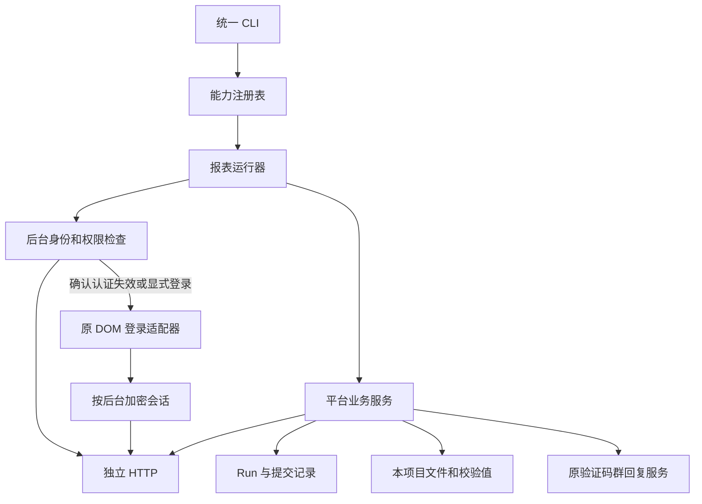

# 架构与接入边界

## 目标

一个命令入口管理所有平台。平台差异保留在各自目录；登录、会话、任务恢复、文件与通知使用共享基础设施。当前交付范围是报表下载；商品上传、修改及上下架可以接入同一账号、HTTP 和任务机制。

命令组织参考 [Catbus](https://github.com/cv-cat/catbus) 的能力注册和分派思路：能力元数据统一生成帮助、参数描述和路由，处理模块按需加载，结果通过固定 JSON 信封返回。这里采用适配现有 Python 自动化的实现。

## 目录

```text
commerce_api/
├─ commerce.ps1                 单一启动入口
├─ pyproject.toml / setup.py    独立安装与 console script
├─ cli/                        参数、帮助、分派、JSON 输出
├─ core/                       日期/请求/结果契约、错误、能力注册表
├─ runtime/                    HTTP、加密会话、身份检查、锁、Run、文件、轮询
├─ integrations/legacy/        只读配置及原登录/验证码/通知适配器
├─ platforms/
│  ├─ douyin/
│  │  ├─ manifest.py
│  │  ├─ backends/merchant/api/reports/
│  │  ├─ backends/qianchuan/api/reports/
│  │  └─ services/reports/
│  ├─ jd/
│  ├─ pinduoduo/
│  ├─ kuaishou/
│  ├─ xiaohongshu/
│  └─ tmall/
├─ config/                     不含真实密钥的计划示例
├─ docs/                       使用、架构、验收说明
├─ tests/                      虚构数据与隔离存储测试
├─ tools/                      开发发现、接口诊断和隔离校验；不进入 wheel
└─ .runtime/                   加密会话、私有响应、任务、捕获和下载；不提交
```

各平台沿用同一布局：`manifest.py` 声明能力；`backends/<后台>/client.py` 管理后台协议、成功码和身份验证；`api/reports/<功能>.py` 保存请求字段、日期、账期和任务匹配规则；`services/reports/<功能>.py` 编排查询、创建、轮询、验证与文件获取。

订单、结算、资金、推广费分别组织。平台内部可以复用同后台协议，不在 CLI 中放置平台判断和请求细节。天猫的千牛、聚合资金、支付宝、淘宝联盟、万相台分别声明后台；拼多多商家、对账中心和推广后台分别声明后台。

## 执行链



所有报表业务请求都经过独立 HTTP。生产业务服务不连接 CDP、不执行页面 fetch、不解析业务 DOM。开发监听工具单独存放，生产命令不导入。

## 会话和跨后台验证

本地会话以 Profile、平台、后台为范围，使用 Windows 当前用户 DPAPI 加密。Cookie 保留域、路径、Secure 和过期信息。原子写入和会话 generation 防止旧请求覆盖新登录或在退出后恢复旧会话。

子后台重新验证授权，主平台登录成功不直接代表子后台成功。千川验证店铺、广告账户和财务读取权限；支付宝另外固定资金账户标识；商家身份、目标后台权限、业务账户分别校验。Run 固定身份范围，续跑不得换到其他店铺或广告账户。

天猫 MTop 使用已证实的 Cookie 域和路径选择签名令牌，每次独立生成新签名，响应更新令牌后再签名。父平台店铺检查保留子后台账户指纹，避免授权未通过时把原账户约束清除。支付宝从认证落地页的日历状态请求取得账户上下文，再用 HTTP 验证资金账户，无需切换业务 DOM 视图。

抖店订单在 `backends/merchant/signing.py` 本地计算 `a_bogus`。SDK 参数从同一加密商家会话的已捕获请求中推导，先校验查询、正文和 User-Agent 摘要；只取已确认的 SDK 和设备参数，不重放捕获的签名或时间戳。HTTP 层完成查询与正文序列化后才调用后台签名钩子，因此分页、日期、导出正文和下载验证码变化时都会重新签名。其他平台和抖店资金、结算接口不启用该钩子；材料不完整时明确返回 `CONTEXT_REQUIRED`，不退回浏览器发送业务请求。

拼多多的父平台身份探测使用独立 HTTP Cookie 容器。真实对比表明商家身份接口会更新共享 Cookie；把这些响应写进推广会话会破坏推广接口上下文。目标后台自身返回的新 Cookie 仍正常保存在目标连接中。

认证检查是低成本 HTTP 请求。一次报表执行最多自动恢复一次浏览器登录。403、429、签名或权限问题不会当作普通登录失效自动重试。

## 提交与恢复

提交导出、发送验证码前先写入意图。平台明确接受后保存任务标识；传输中断或结构无法确认时记录 `unknown`，通过历史任务核查后恢复。没有核查证据时返回 `OUTCOME_UNKNOWN`，不自动重复提交。

相同业务请求复用同一 Run。请求日期、Profile、后台和业务选项冻结；调整轮询时间不会隐式创建新的导出。文件保存在本项目目录，落盘原子替换，记录大小和 SHA-256。跨域文件跳转不转发源后台的认证头。

报表匹配使用完整日期、报表类型和必要业务条件。新任务没有返回 ID 时，通过精确条件及创建前的任务集合核查；无法唯一匹配就保留现场。空数据只有在平台明确返回有效零数量时成立；缺字段、缺账期、未完成或非 JSON 都有单独状态。

## 验证码与通知

继续使用现有 Challenge、群回复、短信来源路由和有效期。平台发码调用 HTTP API。京东归档密码绑定实际 taskId；抖音在下载 OTP 和文件密码阶段切换监听，避免同店铺短信串线。发送结果不明时保留原 Challenge 等待，不重复发码。

抖店 OTP 校验成功后，平台可能只返回 `file_name`，随后还需独立请求文件。该授权结果保存在加密私有状态中；最终取文件独立记录为 `retrieve_file`，续跑直接使用已授权的文件标识，不重复提交已确认的验证码。

默认串行执行并等待回复，减少同群多个请求的匹配歧义。显式短等待退出后，原接收窗口仍有效；如果同时存在多条请求，沿用原服务的消息引用匹配规则。

Challenge 明确过期后按原有策略续建接收请求，并对新请求执行一次发送回调。文件密码的续建使用原有人工确认策略。CLI 可以提前结束本次等待，接收请求仍在原服务中继续有效。

普通失败通过现有群配置和 Feishu 发送通道发送普通任务失败文案。真实登录滑块仍由原登录流程通知，普通接口异常不会调用滑块专用通知。

## 调度与隔离

自动登录检查默认关闭，需要同时开启全局和指定 Profile/后台。默认每天到期检查一次；本地 watch 节拍只读取到期状态，未到期不访问平台。需要人工或发生身份冲突的后台停止自动恢复。

批量报表串行执行，成功项记录检查点。运行器协调本项目账号锁与现有控制器锁，不更改旧锁拥有者信息、旧检查点或旧调度配置。新项目没有注册后台服务或替换现有定时任务。

现阶段登录和通知适配器只读借用原项目模块及配置。业务 API、报表服务、会话、任务及文件属于本目录。后续迁移时，工作台可以调用相同服务或启动相同 CLI，逐项验收后再切换业务入口。

## 后续商品能力

未来为商品操作增加 `services/catalog/` 和 `backends/<后台>/api/catalog/`。新增商品专用请求/结果契约及 CLI resource，继续使用已有的后台会话、权限检查、HTTP、账号锁和持久提交机制。报表的日期和文件契约保持在报表运行器中，不强加给商品操作。

每项写操作独立声明动作、输入、实际影响和结果核查方式。业务状态由平台接口确认，网络失败沿用提交结果不明的处理方式。当前命令表没有暴露商品修改入口。
