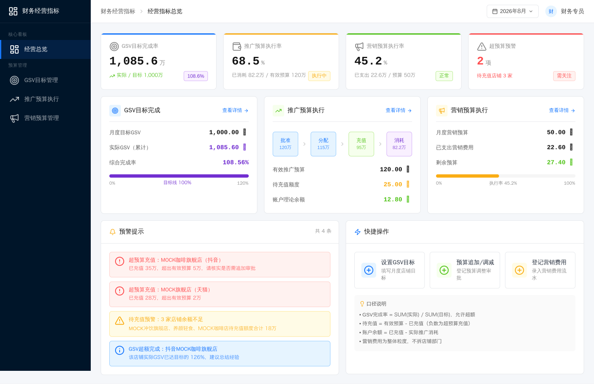
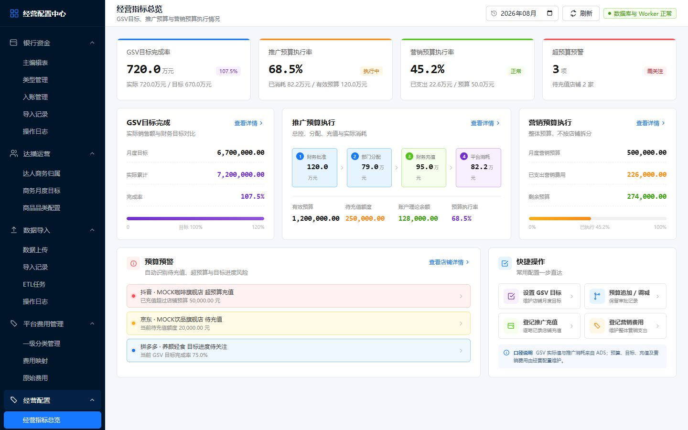

# 经营配置页面 Figma 对比与自测

对照文件：`Tb7MmlCuNLVjnDvBtjIacx`，页面节点 `10:2`。本次按 1440×900 原型拆成四个独立页面，继续使用项目现有后台侧栏、顶栏、一级分类表格、分页及操作列组件。

## 页面与节点

| 页面 | Figma 节点 | 本地实现截图 |
|---|---:|---|
| 经营指标总览 | `10:5` | [截图](screenshots/finance_operating_overview_all_pages_1440x900_20260821.png) |
| GSV目标管理 | `10:390` | [截图](screenshots/finance_gsv_management_all_pages_1440x900_20260821.png) |
| 推广预算执行 | `10:1014` | [截图](screenshots/finance_promotion_execution_all_pages_1440x900_20260821.png) |
| 营销预算管理 | `10:1782` | [截图](screenshots/finance_marketing_management_all_pages_1440x900_20260821.png) |

原型总览与本地总览：

| Figma 原型 | 本地实现 |
|---|---|
|  |  |

## 弹窗与节点

| 弹窗 | Figma 节点 | 本地实现截图 |
|---|---:|---|
| 设置月度 GSV 目标 | `10:841` | [截图](screenshots/finance_gsv_target_dialog_all_pages_1440x900_20260821.png) |
| 推广预算调整申请 | `10:1611` | [截图](screenshots/finance_promotion_adjustment_dialog_all_pages_1440x900_20260821.png) |
| 登记营销费用 | `10:2144` | [截图](screenshots/finance_marketing_expense_dialog_all_pages_1440x900_20260821.png) |

## 对齐结果

- 经营配置导航已拆为四条真实路由：`financeOverview`、`financeGsv`、`financePromotion`、`financeMarketing`；四个入口分别使用独立页面权限，预算总控、店铺明细、充值、调整和营销费用等操作再按动作权限控制；旧 `financeBudget` 哈希自动兼容到经营指标总览。
- GSV 页对齐标题区、导出、批量导入、设置目标、四张统计卡、平台/公司/关键字筛选、明细表、状态与计算说明。
- 推广页对齐“月初批准 → 审批调整 → 有效预算 → 店铺分配 → 累计充值 → 平台消耗”执行链，并提供店铺预算分配、预算调整记录、充值流水、推广消耗四类明细。
- 营销页对齐月度预算、累计费用、剩余预算、执行率、进度说明和费用流水；营销费用继续保持整体月度口径，不拆平台、公司、店铺或部门。
- 三个关键弹窗分别采用 GSV 小弹窗、预算调整审批留痕弹窗、营销费用黄色口径提示弹窗；预算修改、店铺预算分配和推广充值也保留完整表单。
- 表格表头、分页和操作列复用一级分类管理页面的视觉与交互；操作按钮保留悬浮反馈，页面切换、卡片和弹窗均有动画，并支持 `prefers-reduced-motion`。

## 功能自测

- 四条侧栏路由逐页切换成功，页头、选中状态、月份筛选及页面数据正确。
- GSV 目标新增、表单必填、平台到店铺联动、公司 DIM 自动匹配、删除清理通过。
- GSV CSV 批量导入通过；支持中英文表头别名，并对店铺编码、必需字段和已有记录进行校验/更新。
- 推广四个页签切换通过；预算调整新建后为待审批，审批单号、日期、调整类型、金额和原因完整，临时记录已清理。
- 营销费用新增、费用类型筛选、修改预算弹窗、编辑/删除入口通过，临时记录已清理。
- 平台编码、公司编码、审批状态、费用类型、关键字、重置和分页均已接入查询；推广消耗为 ADS 只读明细，不提供误导性的编辑入口。
- 导出按钮完成 CSV 生成并显示成功提示；浏览器测试环境不暴露 Blob 下载事件，但页面无异常日志。
- 1440×900 的四个页面和三个弹窗均完成截图；浏览器控制台错误数为 0。
