# 04 · 原型说明

> 画布：<https://ardot.tencent.com/file/739157683740041> · 导出图：`prototypes/`

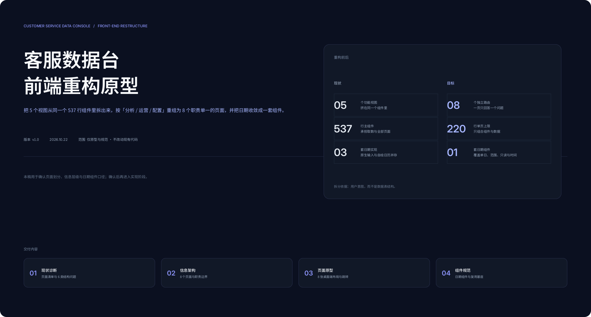
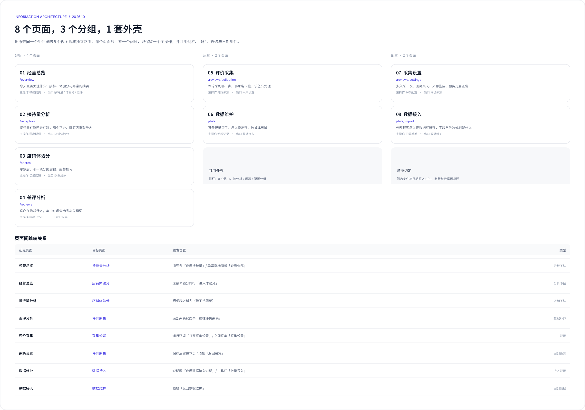
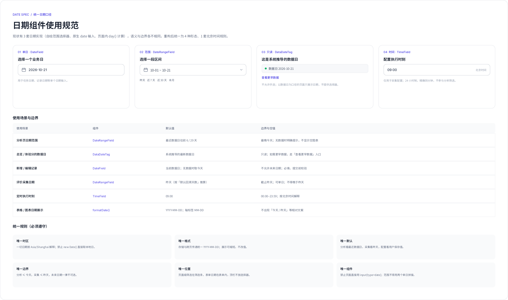

## 1. 页面清单

| #  | 文件                                           | 内容                             |
| -- | -------------------------------------------- | ------------------------------ |
| 00 | `prototypes/00-cover.png`                    | 封面：重构前后对比与交付范围                 |
| 01 | `prototypes/01-information-architecture.png` | 信息架构、8 个页面卡片、8 条跳转关系、共用外壳与跨页约定 |
| 02 | `prototypes/02-date-spec.png`                | 4 种日期形态、6 个使用场景、6 条统一规则        |
| 10 | `prototypes/10-overview.png`                 | 经营总览                           |
| 11 | `prototypes/11-reception.png`                | 接待量分析                          |
| 12 | `prototypes/12-scores.png`                   | 店铺体验分                          |
| 13 | `prototypes/13-reviews.png`                  | 差评分析                           |
| 14 | `prototypes/14-collection.png`               | 评价采集（任务）                       |
| 15 | `prototypes/15-settings.png`                 | 采集设置                           |
| 16 | `prototypes/16-data.png`                     | 数据维护                           |
| 17 | `prototypes/17-import.png`                   | 数据接入                           |
| 99 | `prototypes/99-components.png`               | 组件库：侧栏、KPI、按钮、状态、筛选、面板头、表格     |

画布尺寸：页面 1440 × 1024；规范板 1600 宽；组件库 1400 × 1150。所有页面共用 232px 侧栏、62px 顶栏、24px 内容边距。

## 2. 逐页结构与布局

### 01 经营总览 `/overview`

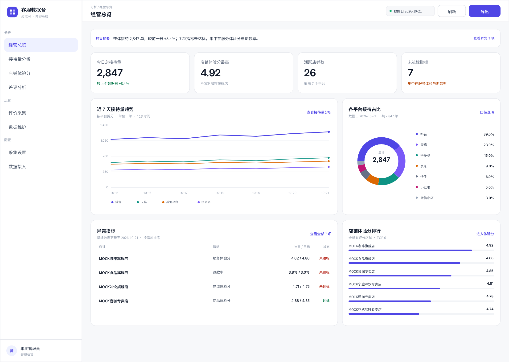

```
顶栏：面包屑 / 标题 · 数据日 · 刷新 · 导出
摘要条 52：昨日摘要（一句话）+ 查看异常
KPI 4 × 116：总接待 / 最高体验分 / 活跃店铺 / 未达标指标
主区 330：近 7 天趋势（700）｜平台占比（452）
次区 300：异常指标（700）｜体验分排行（452）
```

- 主导区域：KPI 行；次主导：趋势。
- 数据日只读，不提供选择器；需要更早数据时走「查看更早数据」。
- 删除了原页面的 CTA 条；下钻改为语义化入口（摘要、异常面板、排行、采集状态）。

### 02 接待量分析 `/reception`

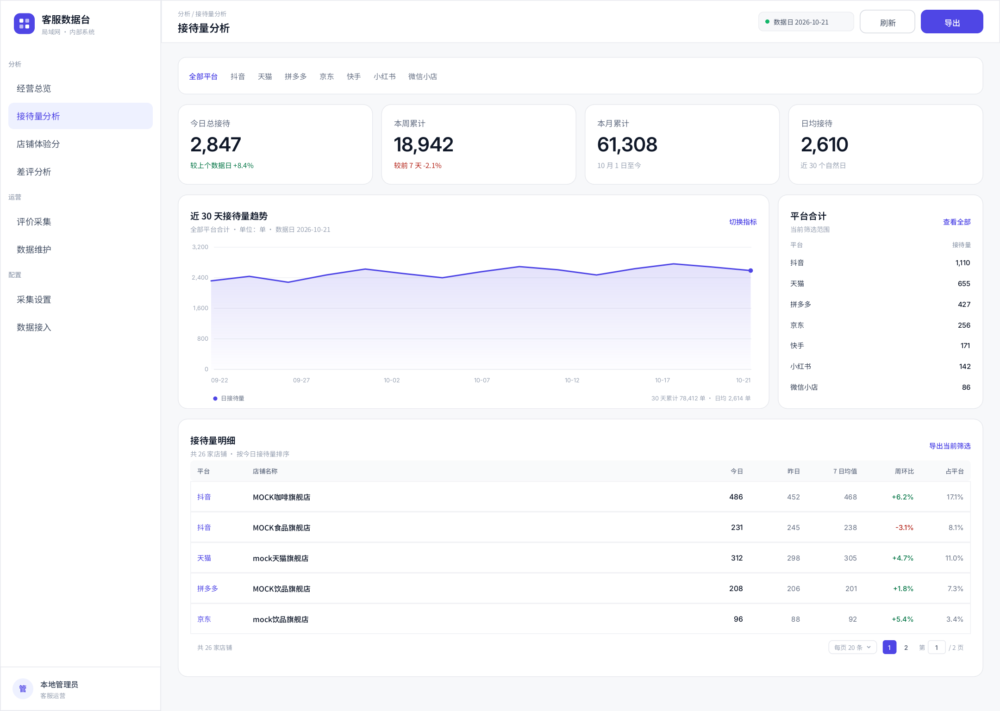

```
筛选条 54：平台标签 8 个（全部/抖音/天猫/拼多多/京东/快手/小红书/微信小店）｜日期范围
KPI 4 × 116：今日 / 本周 / 本月 / 日均
主区 300：30 天趋势（852）｜平台合计（300）
明细 372：平台 / 店铺 / 今日 / 昨日 / 7 日均值 / 周环比 / 占平台 + 分页
```

- 平台标签用文字 + 颜色表示选中，不用大胶囊，避免 8 个按钮把筛选条撑满。
- 明细按「今日接待」降序；店铺名是下钻入口。
- 导出作用域：当前筛选的全部店铺，不是当前页。

### 03 店铺体验分 `/scores`

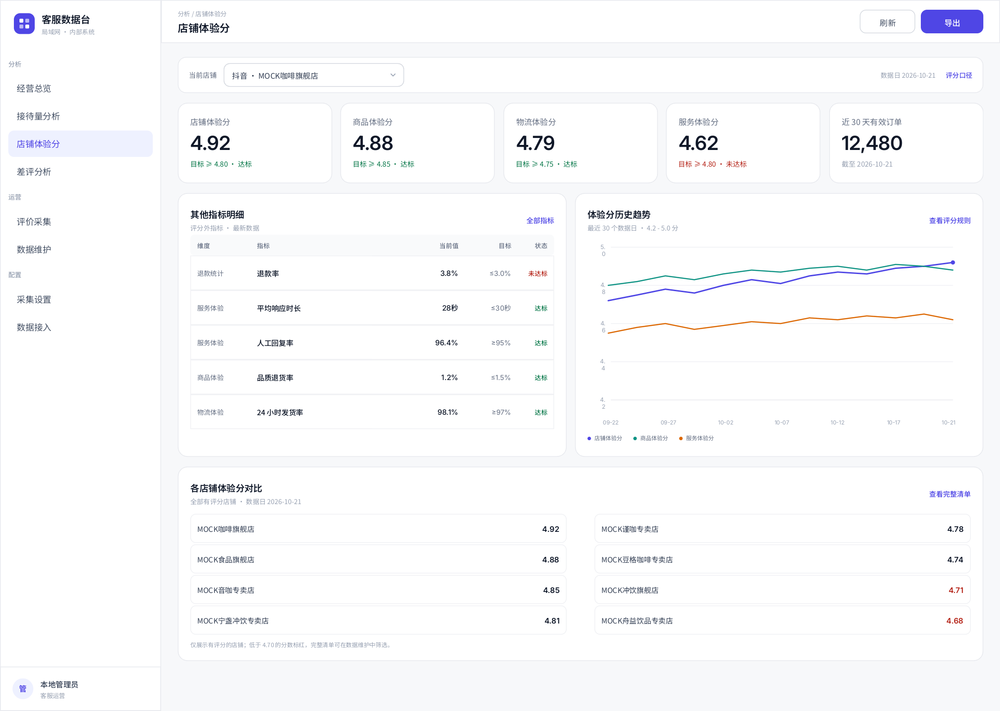

```
店铺选择条 52：当前店铺下拉 · 数据日 · 评分口径
评分卡 5 × 116：店铺 / 商品 / 物流 / 服务 / 近 30 天有效订单
主区 380：其他指标明细（560）｜30 天趋势（592）
对比 280：全店体验分双列清单
```

- 评分卡是本页主导区域；未达标用红色提示，不用整卡变红。
- 「其他指标」只展示评分外指标（退款率、响应时长、回复率、品质退货率、发货率），避免与评分卡重复。
- 对比区只做定位，不承担编辑；编辑去数据维护。

### 04 差评分析 `/reviews`

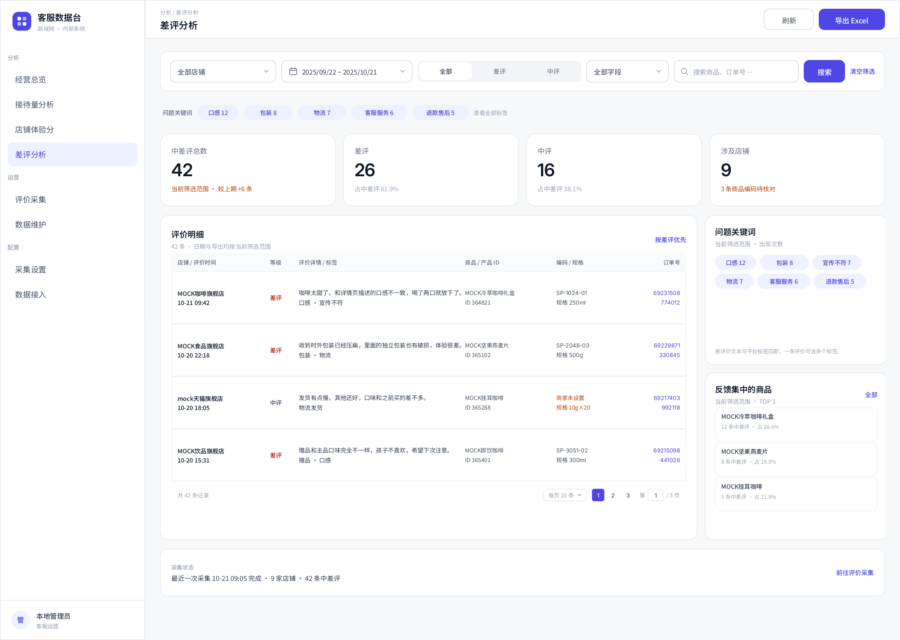

```
顶栏：刷新 · 导出 Excel
筛选卡 96：店铺 / 日期 / 等级（中评+差评·差评·中评）／字段 / 搜索 / 清空
关键词行 40：标签 + 计数（点击即筛选）
KPI 4 × 116：总数 / 差评 / 中评 / 涉及店铺
主区 520：评价明细（860）｜关键词 + 商品 TOP（292）
状态条 76：最近采集时间 · 覆盖店铺 · 前往采集
```

- 本页只读：不做立即采集、不改定时、不重试任务。
- 明细列：店铺/时间、等级、评价详情/标签、商品/产品 ID、编码/规格、订单号（外链）。
- 编码缺失显示「商家未设置」或「待核对」，不用空白。

### 05 评价采集 `/reviews/collection`

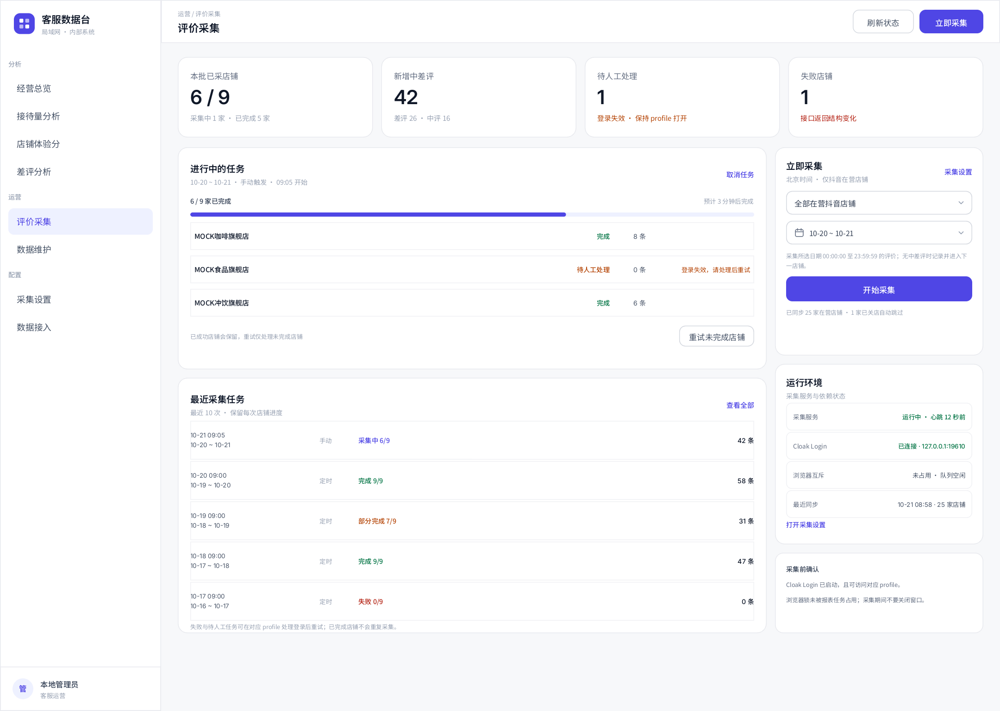

```
KPI 4 × 116：已采店铺 6/9 / 新增 42 / 待人工 1 / 失败 1
左 700：进行中任务 320（进度 6/9 + 3 家店铺 + 重试）｜最近任务 368（5 条）
右 700：立即采集 300（店铺/日期/开始）｜运行环境 260｜采集前确认 116
```

- 本页是「任务控制台」，不出现评价明细；看内容跳差评分析。
- 进度条表示已完成店铺数；待人工与失败分色，不用一个「异常」概括。
- 「重试未完成店铺」只处理未完成店铺，已成功店铺保留。

### 06 采集设置 `/reviews/settings`

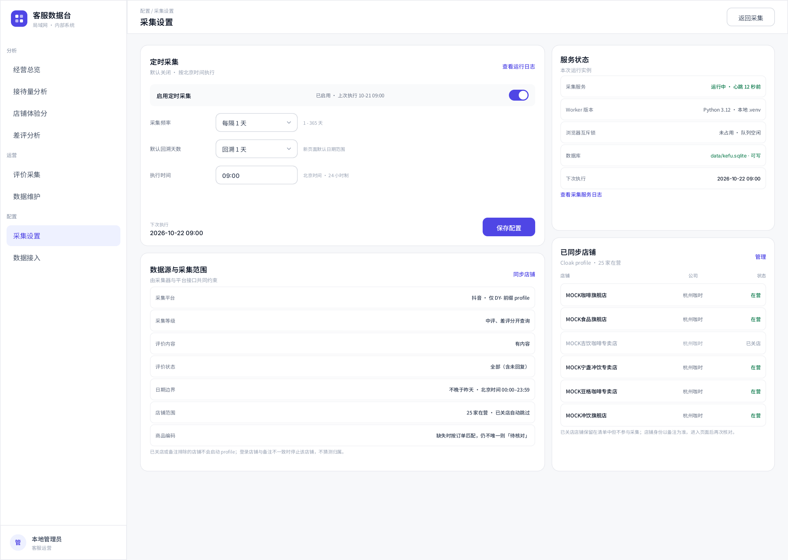

```
左 740：定时采集 368（启用/频率/回溯/时刻/下次执行/保存）｜数据源与范围 400（7 条口径）
右 740：服务状态 340（5 项）｜已同步店铺 428（6 家）
```

- 保存按钮只属于「定时采集」面板，不放到顶栏，避免误解为保存整页。
- 服务状态只展示，不提供重启；重启仍由部署脚本负责。
- 店铺清单标注在营/已关店，已关店不参与采集。

### 07 数据维护 `/data`

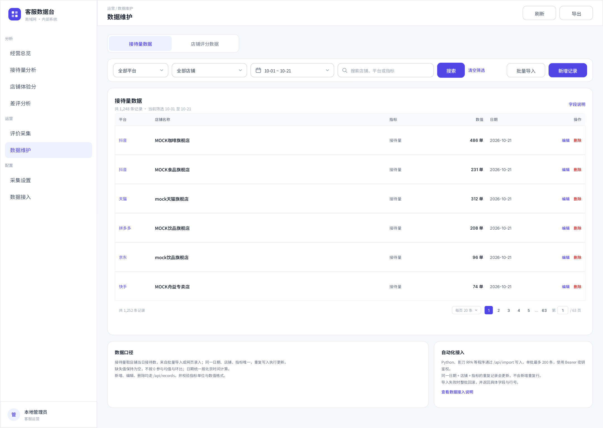

```
顶栏：刷新 · 导出
类型标签 44：接待量数据 / 店铺评分数据
工具栏 56：搜索 / 平台 / 店铺 / 日期范围 / 清空 ｜ 批量导入 / 新增记录
表格 592：平台 / 店铺 / 指标 / 数值 / 日期 / 操作
说明 160：数据口径｜自动化接入
```

- 主操作是「新增记录」，不是「批量导入」；导入是低频入口，放在次级。
- 编辑用弹窗，字段：店铺/指标/数值/日期/备注；删除要求二次确认并显示记录摘要。
- 批量导入跳转 `/data/import`，不在本页弹说明框。

### 08 数据接入 `/data/import`

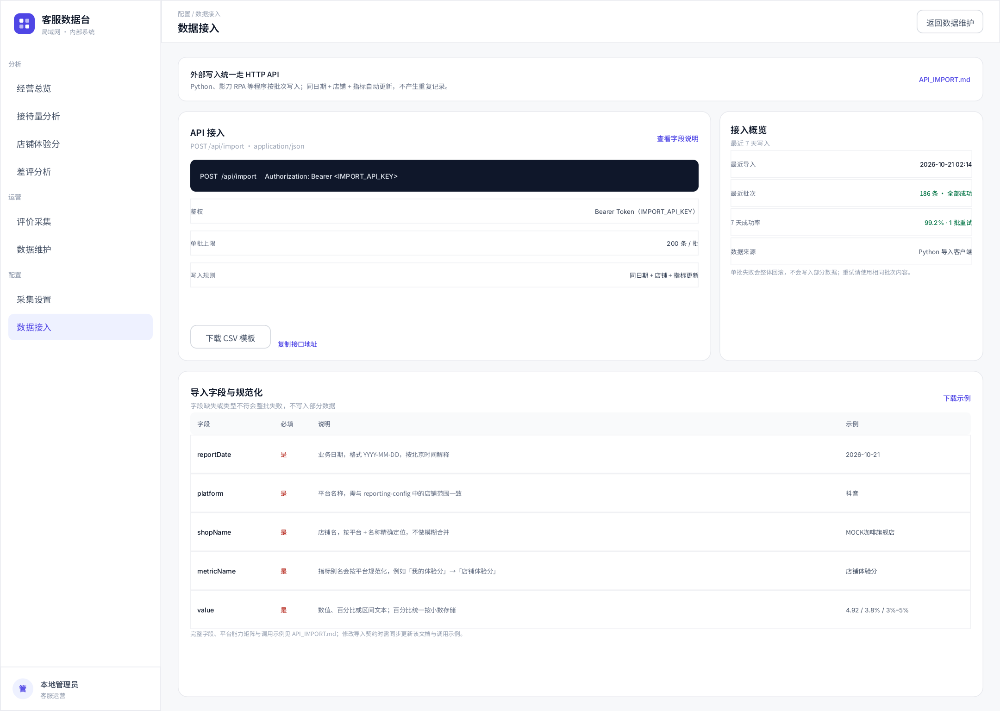

```
说明条 64：统一走 HTTP API + API_IMPORT.md
主区 360：API 接入（端点/鉴权/上限/规则/模板）｜接入概览（4 项）
字段表：字段 / 必填 / 说明 / 示例（5 个核心字段）
```

- 端点用深色代码块，避免和普通文本混在一起。
- 明确「单批 200 条」「同日期+店铺+指标更新」「失败整批回滚」。
- 字段表只列核心 5 个；完整契约仍以 `API_IMPORT.md` 为准。

## 3. 跳转关系

| 起点    | 目标    | 触发位置                     | 类型   |
| ----- | ----- | ------------------------ | ---- |
| 经营总览  | 接待量分析 | 摘要条「查看接待量」/ 异常面板「查看全部」   | 分析下钻 |
| 经营总览  | 店铺体验分 | 体验分排行「进入体验分」             | 分析下钻 |
| 接待量分析 | 店铺体验分 | 明细行店铺名                   | 店铺下钻 |
| 差评分析  | 评价采集  | 底部状态条「前往评价采集」            | 数据补齐 |
| 评价采集  | 采集设置  | 运行环境「打开采集设置」/ 立即采集「采集设置」 | 配置   |
| 采集设置  | 评价采集  | 顶栏「返回采集」/ 保存后留在本页        | 回到任务 |
| 数据维护  | 数据接入  | 说明区「查看数据接入说明」/ 工具栏「批量导入」 | 接入配置 |
| 数据接入  | 数据维护  | 顶栏「返回数据维护」               | 回到数据 |

约定：下钻携带来源与筛选；返回时恢复来源页筛选，不重新取默认值。

## 4. 状态设计

| 状态        | 表现                            | 位置          |
| --------- | ----------------------------- | ----------- |
| 加载        | 分区块骨架：KPI 闪 4 块、图表闪矩形、表格闪 5 行 | 各区块内部，不整页转圈 |
| 空 · 无数据   | 「该日期还没有导入数据」+ 去数据接入 / 切换日期    | 图表、表格       |
| 空 · 筛选无匹配 | 「当前筛选没有匹配记录」+ 清空筛选            | 表格          |
| 错误        | 区块内错误条：「读取失败」+ 重试；保留其余区块      | 面板级         |
| 采集进行中     | 进度条 + 店铺级状态；禁止重复提交            | 评价采集        |
| 待人工       | 橙色状态 + 具体原因（登录/验证码/身份不一致）+ 重试 | 评价采集        |
| 无权限       | 保留页面结构，动作禁用并说明原因              | 全局          |

## 5. 响应式

| 断点        | 规则                           |
| --------- | ---------------------------- |
| ≥ 1280    | 4 列 KPI；主区两栏（约 60/40）        |
| 1024–1279 | KPI 2 列；主区两栏收窄；侧栏 210        |
| 860–1023  | 侧栏变抽屉；主区单列；筛选条换行             |
| ≤ 620     | 单列；表格横向滚动并固定首列；弹窗全屏；日期触发器占满宽 |

## 6. 视觉规格

| 项  | 值                                                                          |
| -- | -------------------------------------------------------------------------- |
| 主色 | `#4F46E5`；浅底 `#EEF1FF`；描边 `#C9CFFF`                                        |
| 墨色 | 主文字 `#101828`；次文字 `#475467`；弱文字 `#98A2B3`                                  |
| 背景 | 页面 `#F7F8FA`；卡片 `#FFFFFF`；表头 `#F9FAFB`                                     |
| 语义 | 成功 `#067647` / `#ECFDF3`；警告 `#B54708` / `#FFFAEB`；危险 `#B42318` / `#FEF3F2` |
| 边框 | `#E7E9EE`（卡片）/ `#D5D9E0`（控件）                                               |
| 字号 | 页面标题 15；KPI 28；区块标题 13–14；正文 10–11；辅助 8–9                                  |
| 字体 | 中文 Noto Sans SC / 系统中文；数字 Inter，`font-variant-numeric: tabular-nums`       |
| 间距 | 4 的倍数；卡片间距 14；卡片内边距 18；页面边距 24/20                                          |
| 圆角 | 卡片 14；控件 9；标签 99；小卡 12                                                     |
| 阴影 | 仅卡片 `0 1px 2px rgba(16,24,40,.04)`，不用大投影                                   |
| 图表 | 类别色：`#4F46E5`、`#7A5AF8`、`#0E9384`、`#DC6803`、`#667085`、`#C11574`、`#94A3B8`  |

## 7. 组件复用矩阵

| 组件                       | 总览 | 接待量 | 体验分 | 差评 | 采集 | 设置 | 维护 | 接入 |
| ------------------------ | -- | --- | --- | -- | -- | -- | -- | -- |
| AppShell / Sidebar       | ✓  | ✓   | ✓   | ✓  | ✓  | ✓  | ✓  | ✓  |
| Topbar（标题 + 动作）          | ✓  | ✓   | ✓   | ✓  | ✓  | ✓  | ✓  | ✓  |
| KpiCard                  | ✓  | ✓   | ✓   | ✓  | ✓  | —  | —  | —  |
| DataPanel / PanelHeader  | ✓  | ✓   | ✓   | ✓  | ✓  | ✓  | ✓  | ✓  |
| DataTable + Pagination   | —  | ✓   | ✓   | ✓  | —  | ✓  | ✓  | ✓  |
| StatusChip               | ✓  | —   | ✓   | ✓  | ✓  | ✓  | —  | —  |
| DateRangeField           | —  | ✓   | ✓   | ✓  | ✓  | —  | ✓  | —  |
| DateField                | —  | —   | —   | —  | —  | ✓  | ✓  | —  |
| DataDateTag              | ✓  | —   | ✓   | —  | —  | —  | —  | —  |
| TimeField                | —  | —   | —   | —  | —  | ✓  | —  | —  |
| Empty / Error / Skeleton | ✓  | ✓   | ✓   | ✓  | ✓  | ✓  | ✓  | ✓  |

## 8. 待确认

1. 差评拆成「分析 / 采集 / 设置」三个入口，导航是否可接受？若希望收敛，可把「采集设置」并入运营组下的二级页，但不建议再合并回分析页。
2. 总览的数据日是否永远只读？若业务需要回看历史，建议提供「查看更早数据」跳转到带范围的分析页，而不是在总览加选择器。
3. 分析范围是否设 366 天上限？现有接口不限制，但会影响查询时间。
4. 数据接入页是否需要「导入批次记录」？当前后端没有批次表，原型未画；若需要，建议新增 `import_batches` 而不是复用 `daily_records`。
5. 数据维护的「导出」是导出当前页还是全部筛选结果？原型按「全部筛选结果」设计，需要后端支持。
6. 竞品店铺（`shops.kind = competitor`）在现有界面没有入口，是否需要在体验分页增加竞品对比？本轮原型未包含。
